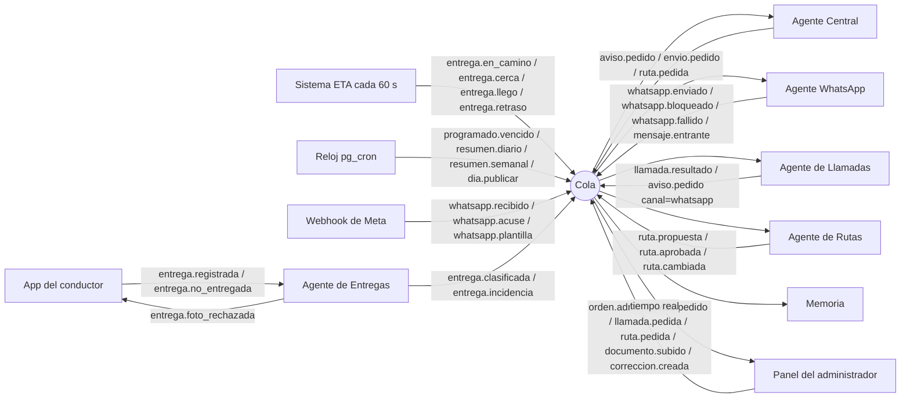
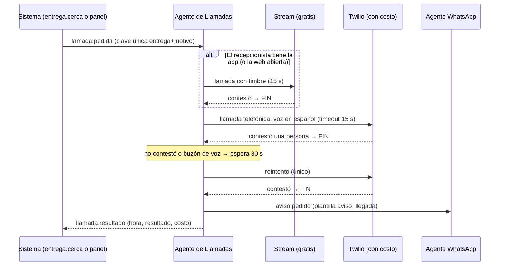

# Agentes de IA, WhatsApp, llamadas automáticas y rutas

**Ampliación de la SPEC · versión 1 · 24 de octubre de 2026**
Propuesta para aprobar **antes** de programar. Manda `00-decisiones-etapa-A.md`; esto amplía `SPEC.md` sin reemplazarla.

---

## 0. En una pantalla
- **Cinco agentes** (Entregas, Central, WhatsApp, Llamadas y Rutas) que **no se llaman entre sí**: cada uno lee eventos de una cola y deja eventos nuevos. Todos actúan dentro de una sola empresa, con permisos mínimos que aplica la base de datos (RLS).
- **Solo tres agentes usan IA.** Entregas usa Haiku 5.5 (mira la foto y clasifica), Central usa Sonnet 5.5 (entiende órdenes y usa herramientas) y WhatsApp usa Haiku 5.5 (clasifica lo que llega y redacta). Rutas usa VROOM y OSRM, y Llamadas usa un guion fijo. Así cuestan menos y siempre se comportan igual.
- **WhatsApp se reutiliza casi entero de Cotigestión:** el webhook, la firma, los duplicados, los acuses, las plantillas con su revisión, el alta con el botón de Meta y el reloj de los mensajes programados. Lo nuevo es el opt-in explícito, las listas de contactos («grupos»), la limpieza de variables y los avisos de entrega.
- **Grupos de WhatsApp:** la API oficial los tiene, pero solo para cuentas oficiales verificadas (insignia azul), con **8 personas como máximo** y entrando por enlace de invitación (sección 10). **No sirven aquí.** Los «grupos» serán listas de contactos en el panel, con un envío individual a cada integrante.
- **⚠ Costo:** WhatsApp es la pieza más cara de toda la app. Con 100 conductores, 3 avisos por entrega costarían **~USD 2.900 al mes**, contra ~USD 300 de todo lo demás. Recomiendo **un solo aviso por entrega** por WhatsApp (sección 14, pregunta 2).
- **Fases:** la 3, 6 y 7 absorben a los agentes Entregas y Central y la modalidad «Enseñarle». Se agrega una fase nueva, **7-W «WhatsApp»**. La 8 suma el Agente de Rutas y la 9 el Agente de Llamadas (sección 15).

---

## 1. Qué leí
| Fuente | Versión | Qué saqué |
|---|---|---|
| `Seek-and-go` · `SPEC.md` completo, `docs/00`, `01`, `03`, `04` | rama `ccr-bbb4d59d-o8lo2o`, commit `e5021c7` | Estados, stack, modelo de datos, reglas del asistente (5), sin señal (6), legal (10) y fases (16) |
| `Sitio.ste` (Cotigestión) · `docs/arquitectura.md`: «Cómo aprende», «El chatbot en WhatsApp», «La plantilla de WhatsApp» y «Lo que sabe, además de los precios» | rama `main`, commit `1307a19` | Regla de aprendizaje, las cuatro trampas del webhook y las plantillas por idioma |
| Cotigestión · `docs/api.md`: «El chatbot en WhatsApp», `/dato` y `/correccion` | ídem | Contrato del ensayo, `origen` que reemplaza y lecciones automáticas o con aprobación |
| Cotigestión · `docs/encender.md` | ídem | Los secretos en Vault, el reloj `pg_cron`, que nada corra en el minuto 0 y los trámites de Meta |
| Cotigestión · código | ídem | `functions/whatsapp`, `functions/programado`, `_compartido/{whatsapp, aprendizaje, alta-meta, numeros-meta, plantillawsp, programado, saber, leerpdf, fondo, limites}.ts` y sus migraciones |
| Documentación de Meta, Twilio y prensa especializada | 24-oct-2026 | Grupos, precios y Twilio Chile (sección 17). **Desde este entorno no se puede abrir `developers.facebook.com`**: lo de Meta viene de fuentes secundarias y se confirma en la consola antes de la Fase 7-W ⚠ |

> **Licencia:** Cotigestión es software propietario de Tomás Quinteros. Reutilizar su código en Reparto requiere el permiso del dueño. Como el encargo lo pide, cada archivo copiado llevará en la cabecera la línea `Procedencia: Cotigestión (Sitio.ste@1307a19)`.

---

## 2. Qué cambia respecto de la SPEC
| Sección de la SPEC | Antes | Ahora | Por qué |
|---|---|---|---|
| Decisiones Etapa A | Sin WhatsApp | WhatsApp oficial de Meta para avisos, rutas y documentos | Pedido del cliente |
| 2, paso 8 «Cerca» | Aviso en la app | Aviso en la app **más** llamada automática al recepcionista (si la empresa la activa) **más** WhatsApp si la persona dio su opt-in | Agente de Llamadas |
| 2, paso 12 «Entregar» | Foto(s) y mensaje opcional | Foto(s) **obligatorias** y mensaje escrito o dictado (ver pregunta 3). La foto la revisa el Agente de Entregas | Pedido del cliente |
| 2, estado `fallida` | Sin detalle | «No entregado» exige **motivo de una lista, foto y mensaje**. El estado sigue siendo `fallida`: **no se crea ningún estado nuevo** | Respetar la SPEC |
| 2 (nuevo) | — | **«Incidencia» no es un estado: es una marca** sobre la entrega (`urgente = sí`), por ejemplo un paquete dañado o que lo recibió otra persona. La pone el Agente de Entregas y la ve el administrador | No romper la máquina de estados |
| 3.9 Llamadas | Descartado el número telefónico (Twilio), por precio | Twilio vuelve **solo como respaldo** de la llamada automática de aviso: llamada de ida, con voz grabada, sin conversación entre personas. **Nadie ve el número de nadie**: marca el servidor | El descarte era para conversaciones conductor–receptor; esto es otra cosa y casi siempre lo resuelve Stream, que es gratis |
| 3.11 / 5 Asistente | Un asistente | Cinco agentes con una cola de eventos (sección 5). El asistente de la SPEC pasa a ser el **Agente Central** | Pedido del cliente |
| 4.1 Datos | — | Tablas nuevas (sección 13). `acciones_asistente` pasa a registrar a **todos** los agentes. `mensajes_programados` suma canal, lista y repetición | |
| 5.2 Modos | Propone / Responde solo | Igual. «Responde solo» también vale para WhatsApp, con los mismos temas permitidos | |
| 5.4 Límites duros | 8 reglas | Las mismas, más: opt-in de WhatsApp, un WhatsApp por aviso y persona, y topes de gasto de WhatsApp y Twilio (sección 12) | |
| 7 Pantallas | — | Panel: Entregas en vivo con foto, Avisos de llegada, Programar (con listas), Grupos, Chat con el Agente Central, Enseñarle, Correcciones, Auditoría y WhatsApp (conexión, plantillas y costos). App: «No entregado» y dictado | |
| 10 Legal | La IA nunca recibe fotos de licencias ni teléfonos | **Las fotos de entrega sí van a la IA** (Anthropic, EE.UU.) para revisarlas. Se suman Meta y Twilio como encargados. Las licencias y los teléfonos siguen sin ir a la IA. Hay que actualizar la Política de privacidad ⚠ | Dato nuevo hacia el extranjero |
| 10 Ley 21.431 | Las decisiones sobre conductores las toma una persona | **Se mantiene.** El Agente de Rutas **propone** cómo repartir entre conductores y el administrador aprueba. Solo reordena **solo** las paradas dentro de la ruta del propio conductor | Asignar es una decisión sobre el conductor |
| 12 Costos | ~USD 270–350 al mes con 100 conductores | Sube según cuántos avisos vayan por WhatsApp (sección 14) | |
| 16 Fases | 0 a 11 | Se suman cosas a las fases 3, 6, 7, 8 y 9, y se agrega la fase 7-W (sección 15) | |

**Lo que no cambia:** los estados de entrega, el stack (Supabase, Expo, Next.js, OSRM y VROOM, Stream), la cola sin señal con UUID, «gana el hecho físico», que nadie ve el teléfono de otro y la retención de datos.

---

## 3. Qué se reutiliza de Cotigestión, archivo por archivo
Cotigestión usa el mismo stack que Reparto (Supabase, Edge Functions en TypeScript/Deno y `pg_cron`), así que sus archivos se pueden traer sin traducirlos. Sus pruebas (`*.prueba.ts`) se traen junto con cada archivo.

**Leyenda:** **Tal cual** = se copia y solo cambian textos o nombres · **Adaptar** = se conserva la lógica y cambia el dominio · **Patrón** = se copia la idea, no el código.

| Archivo de Cotigestión | Qué hace allá | Uso | Qué cambia en Reparto |
|---|---|---|---|
| `_compartido/whatsapp.ts` | Abre el sobre de Meta, verifica la firma sobre el cuerpo crudo, separa mensajes y acuses, lee botones desde `interactive`, parte a 4096 caracteres, `comoSalio`, `queHacerConElAcuse` (`sent` no alcanza y `failed` corta) y `VERSION` única | **Tal cual** | Solo los textos de `loQueSeContesta` (audio, foto o ubicación) y `PARA_QUIEN_LA_ABRIO`. Se mantiene `VERSION = "v23.0"` en un solo lugar, y se confirma la vigente al abrir la Fase 7-W ⚠ |
| `functions/whatsapp/index.ts` | GET de verificación, POST con 200 antes de pensar, `waitUntil`, `wamid` como llave primaria, avisos de plantilla por `waba_id` y acuses guardados | **Adaptar** | En vez de llamar al cotizador, **deja un evento `whatsapp.recibido`** en la cola. El consentimiento implícito («si escribe, consiente») se cambia por el **opt-in explícito** de la sección 9.4. El primer mensaje se guarda como prueba |
| `_compartido/fondo.ts` | `enSegundoPlano` con `EdgeRuntime.waitUntil` | **Tal cual** | — |
| `_compartido/numeros-meta.ts` | Pregunta al token qué números tiene, para no pedir el «Phone number ID» | **Tal cual** | — |
| `_compartido/alta-meta.ts` | Embedded Signup: canje del `code`, suscribir la app al WABA, registrar el número, PIN y mensajes de error | **Tal cual** | Textos «Cotigestión» → «Reparto» |
| `functions/conectar` (la parte de WhatsApp) | Las dos formas de conectar: los cuatro datos o el botón de Meta | **Adaptar** | Pantalla del panel «WhatsApp → Conectar» |
| `_compartido/plantillawsp.ts` | `revisarPlantilla()` (es_CL, variable al principio o al final, signos dentro de las llaves, densidad de variables, botones contiguos, palabras de MARKETING), `cuerpoDeCreacion`, `cuerpoDeEnvio` con el **formato real** (contra el error 132012), `estadoDelAviso` y `cualPlantilla` (si una traducción no está aprobada, manda la que esté) | **Adaptar** | Las plantillas de presupuesto se cambian por las de la sección 9.3. Se agrega `limpiarVariable()`, que no existe en Cotigestión: quita saltos de línea, tabulaciones y más de 4 espacios seguidos. El encabezado PDF pasa a ser opcional |
| `_compartido/programado.ts` | Ventana de 24 h, aviso al programar, tipos y tope de adjunto y normalizar teléfonos chilenos | **Adaptar** | Se suman: destinatario persona, lista o grupo; canal app o WhatsApp; **repetición** (diaria, semanal por días o mensual) |
| `functions/programado/index.ts` | Programar, cancelar y `barrer`: de a uno, bloquea si está fuera de la ventana, sube el adjunto a Meta recién al enviarlo y reintenta máximo 3 veces | **Adaptar** | `barrer` ya no envía: **deja un evento `programado.vencido`** por destinatario, y lo envía el Agente WhatsApp o la app. Al enviar, si es repetitivo, agenda el siguiente |
| `migrations/…_barrer_programados.sql` | El reloj `pg_cron` cada 5 min, con la URL y la clave en **Vault** (nunca en el repositorio) | **Adaptar** | Mismo patrón para **dos relojes**: `reparto_programados` (cada 5 min, desfasado del minuto 0) y `reparto_cola` (cada 10 s, sección 5.2) |
| `migrations/…_mensaje_programado.sql` | Tabla con estado, motivo e intentos; `tomar_programados()` con `for update skip locked` | **Adaptar** | Columnas nuevas (sección 13). La misma función de tomar se usa para la cola de eventos |
| `migrations/…_whatsapp.sql` + `…_una_empresa_un_numero.sql` | Credenciales con **permiso por columna** (la empresa ve número y estado, nunca los secretos); `telefono_id` único; `whatsapp_visto(wamid primary key)` | **Tal cual** | `empresa` → `empresa_id` (nombres de la SPEC) |
| `migrations/…_plantilla_whatsapp.sql` | `plantilla_whatsapp` (con estado, formato y categoría que informa Meta), `consentimiento` y `acuse_whatsapp` | **Adaptar** | `consentimiento` se cambia por `whatsapp_optin` (apagado por defecto, con quién lo activó y la prueba) |
| `_compartido/aprendizaje.ts` | `leccionDe()`: lo seguro y reversible se aplica solo; precio y conflicto esperan a una persona; `nada(porque)` explica cada rechazo; `resumen()` junta lo que se repite | **Adaptar (misma regla, otros tipos)** | Lecciones de reparto (sección 8.2). Se conservan intactos el rechazo de lo que ya se sabía, de las frases sueltas y de los duplicados, y el resumen semanal |
| `functions/correccion/index.ts` | POST de una corrección, GET de pendientes con resumen, aplicar o descartar | **Adaptar** | Pantalla «Correcciones» |
| `_compartido/saber.ts` | Partir un documento en notas con tema, tope de 80, `cabe()` avisa antes del tope, reparos y **la corrección de la primera línea** (`pareceTitulo` mira la línea siguiente) | **Adaptar** | Los reparos dejan de marcar «parece un precio» y marcan «parece un teléfono o un RUT» (datos personales que no deben ir a una nota). Tope configurable por empresa |
| `_compartido/leerpdf.ts` | Saca el texto de un PDF sin bibliotecas | **Tal cual** | — |
| `functions/dato/index.ts` | `/dato`: ensayo (`aplicar: false`), `origen` que reemplaza en vez de duplicar, olvidar y listar con el tope | **Adaptar** | Se llama `/ensenar` y acepta además Excel y texto pegado |
| `_compartido/limites.ts` | Topes con aviso al 80 % | **Adaptar** | Topes de órdenes, gasto de IA, WhatsApp y llamadas (sección 12) |
| `_compartido/planilla.ts` | Lee CSV (separador `;` o `,`, números en formato chileno) | **Adaptar** | Lo usa la lectura de Excel y CSV del Agente Central y la carga masiva |
| `.mcp.json` (MCP de WhatsApp Business de Meta) | Ayuda a dar de alta el número y las plantillas **de nuestra cuenta** desde Claude Code | **Patrón** | Solo como herramienta de soporte, nunca en el producto |
| `functions/whatsapp` → `conversar.ts` / `/cotizar` | El chatbot cotizador | **No se usa** | Reparto no cotiza |

---

## 4. Qué es nuevo (no existe en ninguno de los dos proyectos)
1. **La cola de eventos** y el despachador que reparte cada evento a sus agentes (sección 5).
2. **Una identidad por agente:** un token de sesión que solo vale para su empresa y su agente, con reglas RLS propias (sección 5.3).
3. **Agente de Entregas:** revisa la foto con visión, clasifica, resume y marca urgencias.
4. **Agente Central:** las herramientas de la SPEC 5.3 más leer Excel y PDF, enviar documentos y responder preguntas.
5. **Agente de Llamadas:** Stream, después Twilio, un reintento y al final WhatsApp.
6. **Agente de Rutas:** reparto equilibrado con VROOM y recálculo ante urgencias o atrasos.
7. **Listas de contactos («grupos»)** con su labor y el envío individual a cada integrante.
8. **Opt-in explícito** de WhatsApp por persona.
9. **Lectura de Excel (.xlsx).** Cotigestión solo lee CSV. Se usará la librería SheetJS (`xlsx`) en la función ⚠ versión en la Etapa D.
10. **Modo de prueba por empresa:** WhatsApp, Twilio, Stream y la IA simulados, sin enviar nada real (sección 15.0).
11. **Costo por envío en el panel:** mensajes, minutos y USD por cada aviso.

---

## 5. Cómo se conectan los agentes

### 5.1 La regla
**Un agente nunca llama a otro.** Cada uno:
1. toma de la cola los eventos a los que está suscrito;
2. hace su trabajo con sus herramientas;
3. deja eventos nuevos en la cola y una fila de auditoría.

Ventajas: si el Agente WhatsApp se cae, la entrega igual se registra y la llamada igual sale. Cada paso se reintenta solo y queda registrado. Y se prueba un agente sin levantar los demás.

### 5.2 La cola, en la misma base de datos
- **Tabla `eventos`:** `id`, `empresa_id`, `tipo`, `datos` (JSON), `emisor`, `clave_unica` (única, opcional) y `disponible_en`.
  - `clave_unica` evita los duplicados, igual que el `wamid` de Cotigestión: la frena la base, no un `if`. Por ejemplo, `llamada:E3:cerca` no puede existir dos veces.
- **Tabla `entregas_evento`:** una fila por evento y por agente suscrito, con llave primaria `(evento_id, agente)`, estado, intentos, error y `tomado_en`.
  - Cuando llega un evento, un trigger crea la fila de cada suscriptor según un mapa fijo en el código (sección 6).
- **Quién la recorre:**
  - al insertar un evento, un trigger llama de inmediato a la función `despachar` con `pg_net`, que es la vía rápida;
  - además, el reloj `pg_cron` recorre la cola **cada 10 segundos**, por si la llamada inmediata se perdió. Hace falta para los 15 s y 30 s de las llamadas. `pg_cron` admite intervalos en segundos desde la versión 1.5 ⚠ confirmar en Supabase;
  - toma filas con `for update skip locked`, igual que `tomar_programados()` de Cotigestión.
- **Reintentos:** hasta 3, con espera creciente. Lo que no se va a poder (un 400 de Meta, un número inválido) no se reintenta: queda `fallido` con el motivo, como en `programado`.
- **Descartado: Supabase Queues (pgmq) o un servicio aparte.** Funcionan, pero `skip locked` con llave única ya está probado en Cotigestión, no agrega piezas y se audita con un `select`.

### 5.3 Permisos: cada agente con su propia identidad
La SPEC 5.3 dice que las herramientas corren «con los permisos del administrador». Se mantiene con dos precisiones:
- **Cuando lo pide un administrador** (chat con el Agente Central o un botón del panel), las herramientas usan **la sesión de ese administrador**: su misma RLS.
- **Cuando lo dispara un evento** (el conductor entregó o la ETA llegó a 5 minutos), no hay ningún administrador mirando. El agente usa un **token de 5 minutos** que firma el servidor con estos datos: `empresa_id`, `agente` y `evento_id`.
  - Las reglas RLS miran esos datos: el agente solo ve su empresa, y **menos** que un administrador. Por ejemplo, el Agente de Llamadas no puede leer chats.
  - La clave maestra de Supabase **nunca** se le pasa a un agente.
- **Toda acción con efecto** (enviar, llamar, programar, cambiar una ruta) pasa por **una sola función del servidor** que aplica los límites duros (sección 12). La IA nunca habla directo con Meta, Twilio o Stream.

### 5.4 El modelo es una configuración
La tabla `config_agentes` guarda, por empresa y por agente: modelo, modo (propone o responde solo), topes y si está activo. Valores por defecto:

| Agente | IA | Modelo por defecto | Para qué |
|---|---|---|---|
| Entregas | Sí | `claude-haiku-5-5` | Mirar la foto, clasificar y resumir |
| Central | Sí | `claude-sonnet-5-5` | Entender órdenes y usar herramientas |
| WhatsApp | Sí | `claude-haiku-5-5` | Clasificar lo que llega y redactar respuestas permitidas |
| Llamadas | No | — | Guion fijo con datos de la entrega |
| Rutas | No | — | VROOM y OSRM. El texto de la ruta sale de una plantilla |

---

## 6. Diagrama de eventos: quién emite y quién recibe

| Evento | Lo emite | Lo reciben | Qué provoca |
|---|---|---|---|
| `entrega.registrada` | Servidor, al recibir la entrega de la app (una sola vez por UUID) | Entregas | Revisar la foto, clasificar y resumir |
| `entrega.no_entregada` | Servidor (app: «No entregado») | Entregas | Clasificar el motivo. Si es urgente, se marca |
| `entrega.foto_rechazada` | Entregas | App (push al conductor) | «La foto no muestra el paquete. Toma otra» |
| `entrega.clasificada` | Entregas | Central, Memoria, WhatsApp, panel | Resumen en el panel. Memoria busca lecciones. WhatsApp envía «paquete entregado» si corresponde |
| `entrega.incidencia` | Entregas | Central, WhatsApp (lista de Administración), Rutas, panel | Marca urgente. Aviso a Administración. Rutas evalúa si hay que reordenar |
| `entrega.en_camino` / `entrega.cerca` / `entrega.llego` | Sistema ETA (SPEC 3.7.1) | WhatsApp, Llamadas (solo `cerca`), panel | Aviso de llegada. La llamada automática sale con `cerca` |
| `entrega.retraso` | Sistema ETA | Rutas, Central, panel | Rutas propone un nuevo orden. Central lo informa si se le pregunta |
| `dia.publicar` | Reloj (07:00, configurable) | Rutas | Calcula el orden del día y propone el reparto |
| `ruta.pedida` | Panel o Central | Rutas | Recalcula a pedido |
| `ruta.propuesta` | Rutas | Panel | El administrador ve la propuesta y la aprueba o la edita |
| `ruta.aprobada` / `ruta.cambiada` | Panel (aprobación) / Rutas (reorden dentro de una ruta) | WhatsApp, app, panel | Envía la ruta al conductor por WhatsApp (plantilla `ruta_del_dia`) y la actualiza en la app |
| `aviso.pedido` | Panel, Central o Llamadas | WhatsApp, o la app según el canal | Envía un aviso a una persona o a una lista |
| `llamada.pedida` | Panel o regla de `cerca` | Llamadas | Empieza la secuencia de la sección 11 |
| `llamada.resultado` | Llamadas | Central, panel | Registra hora, resultado y costo. Si nadie contestó, emite `aviso.pedido` por WhatsApp |
| `programado.vencido` | Reloj | WhatsApp o app | Envía el mensaje programado y agenda el siguiente si se repite |
| `whatsapp.recibido` | Webhook de Meta | WhatsApp | Lo clasifica. Lo responde (si está en «Responde solo» y el tema está permitido) o lo deja en la bandeja |
| `mensaje.entrante` | WhatsApp, o el chat de la app | Central, panel | Llega a la bandeja con la sugerencia de respuesta |
| `whatsapp.acuse` | Webhook de Meta | WhatsApp | Actualiza el estado del envío (`delivered`, `read` o `failed`) |
| `whatsapp.plantilla` | Webhook de Meta (por `waba_id`) | WhatsApp, panel | Plantilla aprobada, rechazada o recategorizada |
| `whatsapp.enviado` / `bloqueado` / `fallido` | WhatsApp | Central, panel | Costo y estado de cada envío. `bloqueado` dice por qué (por ejemplo, sin plantilla aprobada o sin opt-in) |
| `orden.admin` | Panel (chat) | Central | Una orden en lenguaje natural |
| `documento.subido` | Panel («Enseñarle») | Central / Memoria | Ensayo de las notas que saldrían |
| `correccion.creada` | Panel («Correcciones») | Memoria | Lección automática o pendiente de una persona |
| `resumen.diario` | Reloj (19:00, configurable) | Central | Arma el resumen. WhatsApp lo envía a la lista de Administración |
| `resumen.semanal` | Reloj (lunes 08:4x) | Memoria | Errores que se repiten, en el panel |

**Ningún reloj corre en el minuto 0** (lección de Cotigestión): a esa hora se encola medio mundo.

---

## 7. Cada agente: rol, herramientas y permisos
**Lectura de las tablas:** **Efecto** = cambia algo o envía algo · **Pasa por el servidor** = la acción se ejecuta en la función central que aplica los límites duros.

### 7.1 Agente de Entregas
- **Rol:** recibe la foto y el mensaje del conductor; revisa que la foto sirva; clasifica la entrega como entregada, fallida o incidencia; resume; y avisa al panel y al Agente Central.
- **Escucha:** `entrega.registrada`, `entrega.no_entregada`. **Emite:** `entrega.foto_rechazada`, `entrega.clasificada`, `entrega.incidencia`.
- **Cuándo revisa la foto:** si el teléfono tiene señal, la app espera la respuesta hasta 8 segundos («Revisando foto…»). Si la foto no sirve, pide otra **en el momento**. Si no hay respuesta en 8 s o no hay señal, la entrega queda registrada igual (**gana el hecho físico**, SPEC 6). La revisión se hace al sincronizar y, si la foto no sirve, el conductor recibe un push y la entrega queda «foto por revisar» para el administrador.
- **Nunca cambia el estado** que puso el conductor. Si su clasificación no calza (el conductor tocó «Entregar» pero escribió «no había nadie»), marca «revisar» para que decida una persona.

| Herramienta | Entra | Sale | Efecto | Permiso |
|---|---|---|---|---|
| `ver_entrega` | `entrega_id` | Dirección, estado, hora comprometida y notas aprendidas de esa dirección | No | Lee solo esa entrega |
| `ver_fotos_entrega` | `entrega_id` | Fotos (enlaces que vencen en 5 min), sin datos EXIF | No | Solo las fotos de esa entrega |
| `pedir_otra_foto` | `entrega_id, motivo` | Push al conductor | Sí (aviso interno) | Solo al conductor de esa entrega |
| `clasificar_entrega` | `entrega_id, clase, resumen, urgente, revisar` | Guardado | Sí (escribe la clasificación, **no el estado**) | Columnas `clasificacion`, `resumen_ia`, `urgente` y `revisar` |
| — | — | — | — | **Prohibido:** escribir a receptores, ver teléfonos, cambiar estados, ver otras entregas |

### 7.2 Agente Central (el cerebro del panel)
- **Rol:** el asistente de la SPEC 5, ampliado. Recibe todo (entregas, fotos, mensajes, documentos y conversaciones), lee Excel y PDF, responde preguntas («¿quién va atrasado?») y envía mensajes y documentos por WhatsApp **a través del Agente WhatsApp** (emite `aviso.pedido` o `envio.pedido`).
- **Modos:** «Propone» por defecto y «Responde solo», como en la SPEC 5.2.
- **Escucha:** `orden.admin`, `entrega.clasificada`, `entrega.incidencia`, `entrega.retraso`, `mensaje.entrante`, `llamada.resultado`, `whatsapp.*`, `resumen.diario` y `documento.subido`. **Emite:** `aviso.pedido`, `envio.pedido`, `ruta.pedida` y `llamada.pedida`.

| Herramienta | Entra | Sale | Efecto | Permiso |
|---|---|---|---|---|
| `buscar_persona` | `{texto, rol?}` | Coincidencias (id, nombre, rol, entrega de hoy), **sin teléfonos** | No | RLS del administrador |
| `ver_entregas` | `{fecha, conductor_id?, sector?, estado?, urgente?}` | Entregas con estado, ETA, retraso y resumen | No | ídem |
| `ver_conversacion` | `{conversacion_id, ultimos}` | Mensajes recientes | No | ídem |
| `consultar_memoria` | `{texto, direccion?}` | Notas y lecciones aplicables | No | Solo su empresa |
| `leer_documento` | `{archivo_id}` | Texto del PDF o filas del Excel/CSV (máximo 5.000 filas) | No | Archivos subidos por la empresa |
| `redactar_mensaje` | `{destinatarios, texto, adjunto_id?, canal}` | Borrador con id, cuántas personas son, si cae fuera de la ventana de 24 h y el costo estimado | No | ídem |
| `enviar_mensaje` | `{borrador_id}` | Enviado, bloqueado (con el motivo) o «pide confirmación» | **Sí**, pasa por el servidor | Límites duros 1–8 |
| `programar_mensaje` | `{borrador_id, enviar_en, repetir?}` | Programado, con aviso de la ventana | **Sí**, pasa por el servidor | ídem |
| `pedir_llamada` | `{entrega_id}` | Llamada en cola | **Sí**, pasa por el servidor | Solo entregas de su empresa activas hoy |
| `pedir_ruta` | `{conductor_id?, motivo}` | Propuesta en el panel (**no aplica nada**) | No | — |
| `generar_codigos`, `cargar_archivo_entregas`, `crear_entregas_desde_vista_previa` | Como en la SPEC 5.3 | ídem | Como en la SPEC | ídem |
| — | — | — | — | **Prohibido:** comparar o rankear conductores, sugerir sanciones (Ley 21.431), revelar teléfonos, escribir fuera de la empresa, aprender sin las reglas de la sección 8 |

- Si hay dos «Juan», **pregunta** cuál; nunca elige al azar (SPEC 5.3).

### 7.3 Agente WhatsApp (chatbot)
- **Rol:** atiende los «grupos» configurados en el panel, cada uno con su labor; envía los avisos (desde la app y desde el panel), los mensajes programados y las rutas; y clasifica lo que llega.
- **Escucha:** `aviso.pedido`, `envio.pedido`, `programado.vencido`, `ruta.aprobada`, `ruta.cambiada`, `entrega.en_camino`, `entrega.cerca`, `entrega.llego`, `entrega.clasificada`, `entrega.incidencia`, `resumen.diario`, `whatsapp.recibido`, `whatsapp.acuse` y `whatsapp.plantilla`. **Emite:** `whatsapp.enviado`, `whatsapp.bloqueado`, `whatsapp.fallido` y `mensaje.entrante`.

| Lista (grupo) | Labor | Qué recibe |
|---|---|---|
| Conductores | Rutas y avisos | `ruta_del_dia`, avisos programados («corte de calle en Irarrázaval») |
| Recepcionistas y clientes | Avisos de llegada y entrega | `aviso_llegada`, `paquete_entregado` |
| Administración | Resumen diario e incidencias | `resumen_diario`, `incidencia_urgente` |

| Herramienta | Entra | Sale | Efecto | Permiso |
|---|---|---|---|---|
| `enviar_plantilla` | `{destinatario_id, plantilla, variables, aviso_id}` | `wamid` o motivo | **Sí**, pasa por el servidor | Opt-in, unique `(aviso_id, destinatario_id)`, topes |
| `enviar_texto` | `{destinatario_id, texto, aviso_id}` | ídem | **Sí**, solo dentro de la ventana de 24 h | ídem |
| `enviar_documento` | `{destinatario_id, archivo_id, aviso_id}` | ídem | **Sí** (el archivo sube a Meta recién al enviarlo) | ídem |
| `ver_mi_entrega` (para responder a quien escribe) | `{remitente}` | Estado, ETA y cómo pagar **de las entregas de ese número** | No | Solo lo de quien escribe |
| `dejar_en_bandeja` | `{mensaje, clasificacion, sugerencia}` | Mensaje en la bandeja | Sí (interno) | — |

- **Lo que llega son datos, no órdenes** (SPEC 5.4.5). Al responder a un receptor, el agente **solo** tiene `ver_mi_entrega` y `dejar_en_bandeja`: aunque le escriban «mándame la lista de clientes», no tiene ninguna herramienta que pueda hacerlo.
- **Un número desconocido** recibe una respuesta genérica, sin ningún dato, y el mensaje queda en la bandeja.
- **Audio, foto sin texto o ubicación:** se responde algo útil sin llamar al modelo (`loQueSeContesta`). Si un conductor manda una foto, queda en la bandeja.

### 7.4 Agente de Llamadas
- **Rol:** llamada automática de aviso al recepcionista cuando la entrega está `cerca` (SPEC paso 8) o cuando el panel la pide. La secuencia está en la sección 11.
- **Escucha:** `entrega.cerca` (si la empresa lo activó), `llamada.pedida` y los avisos de Stream y Twilio. **Emite:** `llamada.resultado` y `aviso.pedido` (canal WhatsApp, si nadie contestó).

| Herramienta | Entra | Sale | Efecto | Permiso |
|---|---|---|---|---|
| `llamar_por_app` | `{entrega_id}` | id de la llamada de Stream | **Sí**, pasa por el servidor | Solo el contacto de recepción de esa entrega |
| `llamar_por_telefono` | `{entrega_id, intento}` | id de Twilio | **Sí**, pasa por el servidor, con costo | ídem. El teléfono lo pone el servidor; el agente nunca lo ve |
| `registrar_resultado` | `{llamada_id, resultado, duracion, costo}` | Guardado | Sí | Tabla `llamadas_automaticas` |
| — | — | — | — | **Prohibido:** llamar fuera del horario configurado (por defecto 08:00–21:00), más de una secuencia por entrega y evento, ver teléfonos |

### 7.5 Agente de Rutas
- **Rol:** calcula el orden y la ruta de cada conductor con OSRM y VROOM y el factor de tráfico aprendido (SPEC 3.7 y 3.7.1). Reparte de forma equilibrada, recalcula ante entregas urgentes o atrasos, y pasa cada ruta al Agente WhatsApp y a la app.
- **Ley 21.431:** el reparto **entre** conductores es una **propuesta** que aprueba el administrador. Reordenar paradas **dentro** de la ruta de un mismo conductor se aplica solo, avisando en la app; no cambia lo que se le asignó.
- **«Equilibrado»** significa minutos de trabajo parecidos entre conductores (VROOM con capacidad por tiempo), no la misma cantidad de paquetes.
- **Escucha:** `dia.publicar`, `ruta.pedida`, `entrega.incidencia` y `entrega.retraso`. **Emite:** `ruta.propuesta` y `ruta.cambiada`. El panel emite `ruta.aprobada`.

| Herramienta | Entra | Sale | Efecto | Permiso |
|---|---|---|---|---|
| `ver_entregas_del_dia` | `{fecha}` | Puntos, horas comprometidas y urgencias | No | Solo su empresa |
| `ver_jornadas` | `{fecha}` | Conductores con jornada y su última posición | No | Solo jornadas de esta empresa |
| `optimizar` | Paradas y conductores | Propuesta (VROOM) con ETA (OSRM × factor) | No | — |
| `proponer_reparto` | `{propuesta}` | Pantalla de aprobación | No (espera a una persona) | — |
| `reordenar_ruta` | `{jornada_id, orden}` | Orden nuevo | **Sí** | Solo el orden dentro de la jornada del mismo conductor |

---

## 8. Memoria: «Enseñarle» y «Correcciones»
Es **memoria consultable**, nunca reentrenar el modelo. El administrador puede ver, corregir y borrar todo.

### 8.1 Pestaña «Enseñarle» (de `saber.ts` y `/dato`)
1. El administrador sube un **PDF**, un **Excel** o pega **texto**.
2. Se muestra un **ensayo**: las notas que saldrían, cada una con su tema, y los reparos («esta nota trae un teléfono»). **No se guarda nada todavía.**
3. Al confirmar, se guardan con su `origen`. **Volver a subir el mismo documento reemplaza sus notas**, sin duplicarlas.
4. **Tope por empresa** (80 notas por defecto, configurable). Se avisa antes de llegar, no al intentar pasarlo.
5. **El error de la primera línea:** en Cotigestión, un PDF cortado por el ancho de la página perdía la primera línea, porque se tomaba como título. Se trae la corrección (`pareceTitulo` mira la línea siguiente) **y su prueba**. Además se agrega una prueba nueva: un PDF real de 3 páginas se lee completo, desde la primera palabra de la página 1 hasta la última de la página 3.

### 8.2 Pantalla «Correcciones» (de `aprendizaje.ts`)
Cuando un agente se equivoca, alguien de la empresa lo corrige ahí mismo, sobre el resumen, la clasificación o la respuesta. **Regla de oro:** se aprende solo lo seguro y reversible.

| Lección | ¿Se aplica sola? | Ejemplo |
|---|---|---|
| `sinonimo_direccion` | **Sí** | «Edificio Torre Sol» = Los Leones 1180 |
| `instruccion_entrega` | **Sí** | «En Los Leones 1180 se deja en conserjería» |
| `dato_cliente` | No: espera a una persona | Cambiar el teléfono, el nombre o la dirección de un receptor |
| `conflicto` | No | Ya se había aprendido que en esa dirección se deja «en la puerta» |
| `ninguna` | No: se guarda como señal | «Clasificó mal la foto» |

- **Se niega a aprender** lo que ensucia sin aportar: algo que ya sabía, una frase suelta (menos de 3 o más de 120 caracteres), un duplicado o un código usado como apodo. Siempre explica por qué a quien corrigió (`nada(porque)` de Cotigestión).
- **Lo que no deja lección se guarda igual.** Un **resumen semanal** (lunes, panel) muestra los errores que se repiten.
- **Las entregas también enseñan, con las mismas reglas.** Si tres conductores distintos escriben «dejado en conserjería» en la misma dirección, se propone la lección `instruccion_entrega`. Se aplica sola solo si no choca con otra; si choca, queda como `conflicto`.

---

## 9. WhatsApp: cada regla y cómo se cumple
### 9.1 Conexión y cuenta
| Regla | Cómo se cumple |
|---|---|
| Solo la API oficial de Meta (Cloud API) | Solo llamadas a `graph.facebook.com`. La CI falla si aparecen `baileys`, `whatsapp-web.js`, `venom-bot` o `wppconnect` en las dependencias |
| No hay forma oficial de conectar un WhatsApp personal | Lo dice la pantalla «Conectar» |
| Para probar: número de prueba de Meta (hasta 5 teléfonos registrados) | Fase 7-W completa con ese número |
| Para producción: número propio que no esté en la app de WhatsApp, verificación del negocio, App Review (`whatsapp_business_messaging` y `whatsapp_business_management`) y URLs públicas de privacidad, términos y eliminación de datos | Lista de trámites en `docs/05-prerrequisitos.md` (se actualiza en la Fase 7-W). La verificación del negocio **tarda días y bloquea todo lo demás**, así que conviene empezarla ya |
| Cada empresa con su número: Tech Provider con Embedded Signup y un WABA por empresa | `alta-meta.ts` tal cual. Mientras no exista el acceso de Tech Provider, queda el camino de los cuatro datos (como en Cotigestión) |
| Token de 24 h en la consola; en producción, token permanente de usuario del sistema | `numeros-meta.ts` detecta el token vencido y lo dice |
| Credenciales con permiso por columna | Migración de Cotigestión tal cual: la empresa ve número y estado, nunca los secretos |

### 9.2 Webhook
| Regla | Cómo se cumple |
|---|---|
| HTTPS público, validado una vez, suscrito a `messages` | `qa/comprobar-webhook.mjs` (nuevo): hace el GET con `hub.challenge`, envía un POST firmado de prueba y verifica que responda 200 en menos de 2 s, **antes** de pegar la URL en Meta |
| Firma `X-Hub-Signature-256` sobre el cuerpo crudo | `firmaValida()` tal cual |
| Empresa por `phone_number_id` (llave única) | `telefono_id unique` |
| 200 antes del modelo, trabajo en segundo plano | Orden del webhook de Cotigestión más `fondo.ts`. Aquí es aún más simple: el webhook solo deja eventos en la cola |
| Duplicados por `wamid` con llave primaria | `whatsapp_visto(wamid primary key)` |
| Acuses: no se contestan; `sent` no alcanza; `failed` corta | `queHacerConElAcuse()` tal cual |
| Avisos de plantilla por `waba_id` | Camino propio del webhook, tal cual |
| Audio, foto sin texto o ubicación sin gastar modelo; botones desde `interactive` | `loQueSeContesta()` y `loQueDijo()` |
| Más de 4096 caracteres se parte | `partir()` por líneas |

### 9.3 Ventana de 24 horas y plantillas
- **Fuera de la ventana se envía una plantilla, o el mensaje queda `bloqueado` con el motivo.** Nunca se intenta para recibir el error 131047.
- **El panel avisa al programar** si el envío caerá fuera de la ventana y no hay plantilla aprobada (de `avisoDeLaVentana`).
- **Plantillas de Utilidad**, en `es` (y `en` solo si una empresa lo pide), cada una con ejemplos:

| Nombre | Cuerpo propuesto (borrador) |
|---|---|
| `aviso_llegada` | Hola {{nombre}}, tu pedido de {{empresa}} llega aproximadamente a las {{hora}}. Puedes seguirlo aquí: {{enlace}}. Gracias. |
| `paquete_entregado` | Hola {{nombre}}, tu pedido de {{empresa}} fue entregado a las {{hora}} en {{lugar}}. Gracias por preferirnos. |
| `ruta_del_dia` | Hola {{nombre}}, tu ruta de hoy con {{empresa}} tiene {{cantidad}} entregas. La primera es a las {{hora}}. Revisa el detalle en la app. |
| `aviso_general` | Hola {{nombre}}, {{empresa}} te informa: {{texto}}. Si tienes dudas, responde este mensaje. |
| `resumen_diario` | Resumen de {{empresa}} del {{fecha}}: {{entregadas}} entregadas, {{fallidas}} no entregadas y {{incidencias}} incidencias. Detalle en el panel. |

- **Cada plantilla pasa por `revisarPlantilla()` antes de ir a Meta:** sin es_CL, sin variable al principio ni al final, sin signos dentro de las llaves, no demasiadas variables para el largo, botones contiguos y sin palabras de MARKETING.
- **«Enviado por el asistente de [empresa]» (SPEC 5.4.7):** con un WABA por empresa, va **fijo en el pie** de cada plantilla de esa empresa (el pie no admite variables, máximo 60 caracteres). En un mensaje libre se agrega al final.
- **Variables limpias:** `limpiarVariable()` quita saltos de línea, tabulaciones y más de 4 espacios seguidos.
- **Formato real:** se guarda el formato que informa Meta (nombrado o posicional) y se envía con ese formato, para evitar el error 132012.
- **Una sola versión de la API de Graph** en todo el código: `VERSION` en `whatsapp.ts`.
- **Traducciones:** mismo nombre, otro idioma y las mismas variables.

### 9.4 Consentimiento (opt-in)
- **Apagado por defecto.** Cada persona lo activa:
  - en la app o la web («Recibir avisos por WhatsApp»); o
  - escribiendo primero al número de la empresa y tocando el botón «Sí, quiero avisos».
- **Prueba:** se guarda en `whatsapp_optin` quién, cuándo, por dónde y el texto exacto. Si fue por WhatsApp, el webhook guarda el `wamid` y el texto del primer mensaje.
- **Un mensaje sin opt-in queda `bloqueado: sin opt-in`.** El panel lo muestra y no se gasta nada.
- Escribir «BAJA» o tocar «No quiero avisos» apaga el opt-in al instante.
- **Un solo WhatsApp por aviso y por persona:** `unique (aviso_id, destinatario_id)` en `envios_whatsapp`. Si el servidor reintenta, la base lo frena.
- **Si WhatsApp falla, no frena nada más:** la notificación de la app y la llamada son eventos independientes.

### 9.5 Mensajes programados (reloj de Cotigestión)
Persona, lista o grupo; canal app o WhatsApp; fecha, hora y repetición. El reloj `pg_cron` lee la URL y la clave desde **Vault** (`reparto_url_funciones` y `reparto_clave_servicio`); en el repositorio queda el nombre del secreto, nunca el secreto. Corre cada 5 minutos, en los minutos `2-57/5` (nunca en el 0).

---

## 10. Grupos de WhatsApp: lo que se verificó
- **Lo que existe:** Meta tiene una **Groups API** dentro de la Cloud API. Según la documentación que citan varias fuentes:
  - solo para **cuentas oficiales de empresa** (Official Business Account, con insignia azul verificada);
  - **8 participantes como máximo**, contando a la empresa;
  - la empresa **no puede agregar personas**: entran por un **enlace de invitación** o pidiendo unirse;
  - hasta ~10.000 grupos por número; cada mensaje se cobra por cada integrante que lo recibe.
- ⚠ No pude abrir `developers.facebook.com` desde este entorno. Estos datos vienen de fuentes secundarias (sección 17) y se confirman en la documentación oficial al abrir la Fase 7-W.
- **Conclusión:** no sirve. Una empresa nueva no tiene insignia azul, un grupo de conductores pasa fácil de 8 personas, y no se puede sumar a un conductor nuevo sin que acepte un enlace.
- **Lo que se hace:** los «grupos» son **listas de contactos administradas en el panel** (tablas `grupos` y `grupo_miembros`), con su labor, y el envío es **individual** a cada integrante. Ventajas:
  - cada persona tiene su propio opt-in;
  - nadie ve el teléfono de los demás integrantes, como exige la SPEC 9;
  - el costo y el estado de cada envío se ven por persona.
- Un envío a una lista de más de 10 personas **siempre pide confirmación** (SPEC 5.4.2).

---

## 11. Llamada automática: la secuencia

- **Si no tiene app, o tiene la web cerrada** (SPEC 3.9: el timbre web solo suena con la página abierta), se salta Stream y se va directo a Twilio.
- **Se detiene en cuanto alguien contesta.** Twilio detecta si atendió una persona o un buzón de voz (Answering Machine Detection, ~USD 0,0075 por llamada ⚠). El buzón cuenta como «no contestó».
- **Guion fijo, sin IA:** «Hola, te llamamos de parte de Despachos Cordillera. Tu pedido llega en unos 5 minutos. Este es un aviso automático del asistente de Despachos Cordillera.» Se repite una vez.
  - **Voz:** Twilio no tiene voz chilena; se usa `es-US` o `es-MX` ⚠ se elige al escucharlas en la Fase 9.
- **Registro en `llamadas_automaticas`:** hora de cada intento, canal (Stream o Twilio), resultado (contestó, no contestó, buzón, ocupado, falló), duración y costo.
  - Twilio informa el precio real unos minutos después, en su aviso de estado; mientras tanto se guarda el estimado.
- **Una sola secuencia por entrega y motivo** (`clave_unica`).
- Twilio necesita un **número de salida**. Un número chileno exige papeles de la empresa ante Twilio ⚠ costo y plazo en la Fase 9. Mientras tanto se puede probar con la cuenta de prueba de Twilio, que solo llama a números verificados.

---

## 12. Límites duros (los aplica el servidor, no la IA; SPEC 5.4)
Todos viven en **una sola función del servidor** (`ejecutar_accion`), por la que pasa cada envío, llamada o programación de cualquier agente. Cada límite tiene su prueba.

| # | Límite | Dónde se aplica |
|---|---|---|
| 1 | Nunca escribe a un receptor sin orden del administrador o sin «Responde solo». Los avisos automáticos de llegada cuentan como orden **solo** si el administrador encendió «Avisos de llegada automáticos» en Configuración | `ejecutar_accion` revisa el origen del evento y la configuración |
| 2 | Más de 10 destinatarios: siempre pide confirmación | Devuelve «pide confirmación» y no envía |
| 3 | Solo dentro de la empresa | RLS más la verificación de `empresa_id` del destinatario |
| 4 | Nunca revela datos ni teléfonos de otros | Las herramientas nunca devuelven teléfonos; `ver_mi_entrega` filtra por el número que escribió |
| 5 | Lo que llega (WhatsApp, app) son datos, no órdenes | El Agente WhatsApp, al responder, solo tiene `ver_mi_entrega` y `dejar_en_bandeja` |
| 6 | Topes de uso y gasto por empresa (IA, WhatsApp y Twilio), con aviso al 80 % | `limites.ts` adaptado. Al llegar al 100 %, la IA se corta y WhatsApp y las llamadas quedan `bloqueado: tope`. La notificación de la app nunca se corta |
| 7 | Todo mensaje va marcado «enviado por el asistente de [empresa]» y queda en `acciones_asistente` | Pie de la plantilla o texto agregado, más la fila de auditoría (agente, evento, herramienta, datos, resultado, modelo, tokens y costo) |
| 8 | Fotos con acceso restringido y borradas por retención | Bucket privado, enlaces de 5 min, sin EXIF y borrado a los 12 meses (SPEC 10). A Meta se sube un archivo solo si se envía, y Meta lo guarda 30 días |
| 9 | Opt-in de WhatsApp y un WhatsApp por aviso y persona | `whatsapp_optin` y `unique (aviso_id, destinatario_id)` |
| 10 | Llamadas solo dentro del horario configurado y una secuencia por entrega | `clave_unica` y horario en `config_agentes` |

---

## 13. Datos nuevos (tablas)
| Tabla | Qué guarda | Campos clave |
|---|---|---|
| `eventos` | La cola | id, empresa_id, tipo, datos, emisor, clave_unica (única), disponible_en, creado_en |
| `entregas_evento` | Un evento por agente | (evento_id, agente) PK, estado, intentos, tomado_en, error |
| `config_agentes` | Configuración por empresa y agente | empresa_id, agente, modelo, modo, activo, topes, horario_llamadas, avisos_automaticos |
| `acciones_asistente` (ampliada) | Auditoría de todos los agentes | + agente, evento_id, modelo, tokens_entrada, tokens_salida, costo_usd |
| `clasificaciones_entrega` | Lo que dijo el Agente de Entregas | entrega_id, clase, resumen, urgente, revisar, foto_ok, motivo_foto |
| `whatsapp` | Conexión (de Cotigestión) | empresa_id **único**, telefono_id **único**, waba_id, secretos con permiso por columna |
| `whatsapp_visto` | Duplicados de Meta | wamid PK |
| `acuse_whatsapp` | Estado de cada envío | wamid PK, estado, error |
| `plantilla_whatsapp` | Plantillas (de Cotigestión) | empresa_id, nombre, idioma, estado, formato, categoría |
| `whatsapp_optin` | Consentimiento | empresa_id, persona_id, activo, cuando, por_donde, prueba (texto o wamid) |
| `grupos` / `grupo_miembros` | Listas de contactos | empresa_id, nombre, labor / grupo_id, persona_id |
| `envios_whatsapp` | Cada envío individual | aviso_id, destinatario_id (**unique** juntos), plantilla, wamid, estado, motivo, costo_usd |
| `mensajes_programados` (ampliada) | + canal, grupo_id, repeticion, proximo_en | (de Cotigestión) |
| `llamadas_automaticas` | Cada intento | entrega_id, motivo, intento, canal, resultado, duracion_s, costo_usd, id_proveedor |
| `notas_agente` | «Enseñarle» | empresa_id, tema, contenido, origen, creado_por |
| `correcciones` / `lecciones` | Aprendizaje | campo, dicho, antes, despues, lección, automática, aplicada, quien |
| `rutas_propuestas` | Propuestas del Agente de Rutas | fecha, propuesta, estado (propuesta, aprobada, descartada), aprobada_por |
| `uso_empresa` | Consumo para los topes | empresa_id, día, tokens, costo_ia, mensajes_wsp, costo_wsp, minutos_tel, costo_tel |

Cada tabla tiene RLS y su prueba pgTAP (SPEC 11).

---

## 14. Costos (⚠ confirmar con la tabla oficial de Meta, que cambia cada 3 meses)
**Precios usados:**
- **WhatsApp:** Meta cobra por mensaje desde julio de 2025. **Desde el 1 de octubre de 2026** también cobra las respuestas dentro de las 24 horas (mensajes de servicio), después de los primeros **1.000 del mes por número**, al precio de Utilidad del país. Una plantilla de Utilidad en Chile cuesta **~USD 0,020**. Dentro de la ventana de 24 horas, las plantillas de Utilidad ya no son gratis.
- **Twilio:** llamada a celular chileno **~USD 0,075 por minuto**, más la detección de buzón (~USD 0,0075 por llamada) y el número (⚠).
- **Stream:** dentro del cupo gratis (SPEC 3.9).
- **IA del Agente de Entregas** (Haiku 5.5 con visión): ~2.500 tokens por foto → ~USD 0,0004 por entrega.

| Escenario mensual | Validación (5 conductores, ~2.400 entregas) | 100 conductores (~48.000 entregas) |
|---|---|---|
| Lo de la SPEC 12 | ~45 | ~270–350 |
| Agente de Entregas (IA con fotos) | ~1 | ~20 |
| Agente Central y WhatsApp con más uso (IA) | ~2 | ~40 |
| **WhatsApp, 1 aviso por entrega** (`aviso_llegada`) | ~48 | **~960** |
| WhatsApp, 3 avisos por entrega (en camino, cerca y entregado) | ~144 | **~2.880** |
| Rutas y resúmenes por WhatsApp (1 por conductor al día y 1 a administración) | ~3 | ~55 |
| Llamadas por Twilio (si el 10 % de las entregas cae a teléfono, ~1 min) | ~20 | ~400 |
| **Total con 1 aviso por WhatsApp** | **~120** | **~1.750–1.850** |

**Recomendación:**
- **Un solo WhatsApp por entrega:** `aviso_llegada`, con la hora y el enlace de seguimiento.
- El resto («cerca», «llegó» y «entregado») va por la app o la web, que son gratis.
- WhatsApp se usa **solo con quien no tiene la app**.
- La llamada automática se activa por empresa.

Con eso, el costo de WhatsApp baja a menos de la mitad, según cuántos receptores tengan la app. El panel muestra cuántos mensajes y cuánto costó cada envío, y el gasto acumulado del mes.

---

## 15. Fases (se integran a la sección 16 de la SPEC al aprobar)
### 15.0 Para todas las fases
- **Modo de prueba por empresa** (`modo_prueba = sí`): WhatsApp, Twilio, Stream y la IA se cambian por **proveedores simulados** que guardan lo que «habrían enviado» en `envios_simulados` y generan acuses falsos (`delivered`, `failed`).
  - El panel muestra una franja amarilla: «Modo de prueba: no se envía nada real».
  - **La CI siempre corre en este modo.**
- **Pruebas:** cada función con IA trae casos de evaluación (como el set de 30 de la SPEC 11), y el **simulador del día de Matías** se amplía con los avisos de WhatsApp y la llamada. Cada aviso debe salir **a la hora esperada y una sola vez**.

### 15.1 Cambios por fase
| Fase | Se agrega | Listo cuando… |
|---|---|---|
| **3. Conductor: el día** | «Entregar» con fotos obligatorias y mensaje escrito o dictado (dictado del teclado del teléfono: gratis y funciona sin señal en la mayoría de los equipos); «No entregado» con motivo, foto y mensaje; hora y GPS automáticos; cola de eventos; **Agente de Entregas**; auditoría base | Con dos teléfonos haces el día de Matías: una foto borrosa a propósito se rechaza **en el momento**; «No entregado» exige motivo; el panel muestra foto, mensaje, hora, ubicación y resumen al instante; una incidencia aparece en rojo como urgente |
| **6. Mensajería** | Programar a persona, lista o grupo, por la app; repetición; reloj `pg_cron` con Vault (de Cotigestión); listas de contactos en el panel | El aviso de las 08:20 sale a esa hora, una vez, a la lista «Conductores»; uno semanal sale dos lunes seguidos |
| **7. Asistente de IA** | **Agente Central** (herramientas, modos, leer Excel y PDF); «Enseñarle»; «Correcciones»; memoria de entregas; resumen semanal; topes con aviso al 80 % | Además de lo de la SPEC: subes un PDF de 3 páginas y el ensayo muestra el texto completo, **con su primera línea**; subirlo otra vez no duplica; corriges «en Los Leones 1180 se deja en conserjería» y se aplica sola; corregir el teléfono de un cliente queda pendiente de aprobación; repetir algo ya sabido se rechaza con su motivo |
| **7-W. WhatsApp (nueva)** | Conexión (cuatro datos y Embedded Signup); webhook; `qa/comprobar-webhook.mjs`; plantillas con `revisarPlantilla()`; opt-in; listas con envío individual; ventana de 24 h; **Agente WhatsApp**; costos en el panel. Todo con el **número de prueba de Meta (5 teléfonos)** | Meta valida el webhook a la primera; un mensaje duplicado (mismo `wamid`) se atiende una vez; una firma falsa recibe 401; sin opt-in queda «bloqueado: sin opt-in»; fuera de la ventana sin plantilla queda «bloqueado» y el panel lo avisó al programar; con plantilla aprobada llega `aviso_llegada`; «BAJA» apaga el opt-in; un mensaje con trampa no logra datos de nadie |
| **8. ETA, retraso y orden** | **Agente de Rutas**: reparto equilibrado propuesto, aprobación del administrador, recálculo ante urgencia o atraso, ruta por WhatsApp y en la app | Además de lo de la SPEC: a las 07:00 aparece la propuesta; al aprobarla, cada conductor recibe `ruta_del_dia` una vez; una entrega urgente nueva reordena la ruta de Matías sin moverla a otro conductor sin aprobación |
| **9. Llamadas** | **Agente de Llamadas**: Stream, Twilio (voz en español), reintento a los 30 s y después WhatsApp; registro de hora, resultado y costo | Con la app del receptor cerrada, suena por Stream; si no contesta en 15 s, suena su teléfono; si tampoco, reintento a los 30 s y luego llega el WhatsApp; si contesta en el primer intento, no sale nada más; el panel muestra el costo |

---

## 16. Preguntas para aprobar este diseño (máximo 4)
1. **¿Quién es el «recepcionista»?** ¿El receptor de la entrega o una persona aparte (conserje o recepción del lugar de destino)?
   *Propuesta:* cada entrega tiene un «contacto de recepción» opcional; si no se indica, es el receptor.
2. **¿Cuántos avisos por WhatsApp por entrega?** Es lo que más pesa en el costo (sección 14).
   *Propuesta:* uno solo (`aviso_llegada`), solo a quien no tiene la app; el resto por la app.
3. **El mensaje al entregar, ¿obligatorio u opcional?** La SPEC lo dejaba opcional, y escribir de pie con un paquete en la mano cuesta.
   *Propuesta:* obligatorio solo en «No entregado»; en «Entregar», opcional y con dictado a un toque.
4. **¿Un número de WhatsApp por empresa o uno solo de Reparto para todas?**
   *Propuesta:* uno por empresa con Embedded Signup, como en Cotigestión. Durante la validación, un solo número conectado con los cuatro datos.
   *Trámite que conviene empezar ya:* la verificación del negocio en Meta, que tarda días y bloquea todo lo demás.

---

## 17. Fuentes (consultadas el 24-oct-2026)
- Grupos: [Unipile, «WhatsApp Group API 2026»](https://www.unipile.com/whatsapp-group-api/), [Ominiflow, «WhatsApp Groups API 2026 – OBA»](https://ominiflow.com/blog/whatsapp-groups-api), [islash, «Groups API»](https://islash.io/user-guide/groups-api), [Wuseller, guía 2026](https://www.wuseller.com/whatsapp-business-knowledge-hub/whatsapp-groups-api-create-manage-groups-2026-guide/). ⚠ Confirmar en developers.facebook.com.
- Precios de WhatsApp: [Meta, «Pricing on the WhatsApp Business Platform»](https://developers.facebook.com/documentation/business-messaging/whatsapp/pricing), [YCloud, cambio del 1-oct-2026](https://www.ycloud.com/blog/whatsapp-api-message-pricing-update-effective-october-1-2026), [Wati, mensajes de servicio](https://www.wati.io/en/blog/whatsapp-service-message-pricing/), [respond.io, cambio 2026](https://respond.io/blog/whatsapp-pricing-change-2026), [sent.dm, tabla por país](https://docs.sent.dm/docs/guides/whatsapp-pricing).
- Twilio Chile: [Twilio Voice pricing, Chile](https://www.twilio.com/en-us/voice/pricing/cl).
- Proyectos base: `Seek-and-go@e5021c7` y `Sitio.ste@1307a19`.
